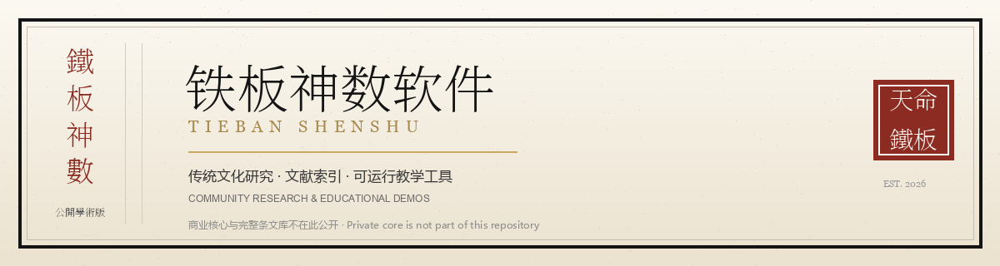

<p align="center">
  
</p>

<h1 align="center">Tieban Shenshu</h1>
<p align="center"><strong>Tieban Shenshu Community Edition</strong></p>

<p align="center">
  <a href="README.md">简体中文</a> ｜
  <a href="README.zh-HK.md">繁體中文 (HK/MO)</a> ｜
  <a href="README.zh-TW.md">正體中文 (TW)</a> ｜
  <strong>English</strong>
</p>

<p align="center">
  24 documents in 4 languages · 6 CLI commands · 26 unit tests · 5 CI checks
</p>

🌐 **Online knowledge base (GitHub Pages)**: [read now](https://tiebanshenshuapp-bot.github.io/tiebanshenshu/) — 25 pages in 4 languages, no clone needed.

---

## Six entry points

| | Entry | What it is |
|---|---|---|
| 📖 | **[Overview](docs/en/index.md)** | What Tieban Shenshu is, how it differs from BaZi, what is known vs unknown |
| 🔤 | **[Glossary](docs/en/glossary.md)** | *Kaoke*, *dingfen*, *tiaowen*, *taixuan* — each labelled by **evidence level** |
| 🛠 | **[Educational tools](demo/README.md)** | Zero-dependency Python, 6 commands, runs locally, uploads nothing |
| 📚 | **[History & debates](docs/en/history.md)** | Timeline, Yang Shen's criticism, open questions |
| 🔬 | **[Research methods](docs/en/research-methods.md)** | How we judge, how we cite, how to evaluate our credibility |
| 🌍 | **[Public project survey](research/README.md)** | Licence analysis of 19 related GitHub projects (reproducible) |

<p align="center">
  <a href="https://tiebanshenshuapp.com"><strong>Official website</strong></a> ｜
  <a href="https://tiebanshenshuapp.com/trial"><strong>Free trial</strong></a> ｜
  <a href="CONTRIBUTING.md">Contributing</a> ｜
  <a href="docs/en/faq.md">FAQ</a>
</p>

---

## What this is

This repository is the **public research community and educational demo project** for **Tieban Shenshu** (鐵板神數 / 铁板神数, also written 鐵版神數 — "Iron Plate Divine Numbers").

Tieban Shenshu is a Qing-dynasty Chinese numerology system attributed by tradition to Shao Yong (邵雍, 1011–1077) of the Northern Song. It is known for **kaoke** (考刻) — narrowing a birth time to a specific fifteen-minute *ke* — and for mapping derived numbers to numbered verses (條文 / tiaowen) in a corpus of roughly twelve thousand entries.

It is a historical divination text worth studying as literature, and a tradition whose origins and authenticity remain actively debated.

**What we publish here:**

- Introductory material, terminology, and a research index
- Independent, runnable **educational tools** (no commercial engine involved)
- Citation methods and source provenance for public literature
- A small number of **clearly attributed** public excerpts

**What we do not publish here:**

- The private commercial engine, the complete verse corpus, or the full kaoke rule set
- Commercial client source code, installers, licensing, or payment implementation
- Any customer name, birth data, reading report, or order record

> **The commercial software and its private algorithms are not part of this repository.** For full functionality, visit the official website.

---

## Official links

| Purpose | URL | Status |
|---|---|---|
| Official website | https://tiebanshenshuapp.com | Verified reachable |
| Free trial | https://tiebanshenshuapp.com/trial | Verified as a live trial page |

> These are the **only official entry points**. This community does not distribute commercial software and does not claim lineage authority on behalf of any school.

---

## Quick start (no installation)

This repository ships a **zero-dependency** educational tool. Python 3.9+ is all you need:

```bash
git clone https://github.com/tiebanshenshuapp-bot/tiebanshenshu.git
cd tiebanshenshu/demo

# 1. Sexagenary cycle: Gregorian year -> ganzhi
python tieban_open_tools.py ganzhi 1984

# 2. Look up a position in the 60-term cycle
python tieban_open_tools.py jiazi 甲子

# 3. Terminology lookup (labels "traditional account" vs "scholarly discussion")
python tieban_open_tools.py term 考刻

# 4. Verse-number format check (synthetic samples only, no real verses)
python tieban_open_tools.py check 4082

# 5. Citation generator
python tieban_open_tools.py cite "皇极经世"
```

The tool runs **entirely locally**. It makes no network calls, uploads nothing, and never asks for birth data. See [demo/README.md](demo/README.md).

---

## Documentation map

| Topic | English |
|---|---|
| Overview | [docs/en/index.md](docs/en/index.md) |
| Getting started | [docs/en/getting-started.md](docs/en/getting-started.md) |
| Glossary | [docs/en/glossary.md](docs/en/glossary.md) |
| History and debates | [docs/en/history.md](docs/en/history.md) |
| Research methods | [docs/en/research-methods.md](docs/en/research-methods.md) |
| FAQ | [docs/en/faq.md](docs/en/faq.md) |

Other languages: [简体中文](README.md) ｜ [繁體中文（香港／澳門）](README.zh-HK.md) ｜ [正體中文（台灣）](README.zh-TW.md)

---

## How we treat this material

Three rules.

**1. Separate the evidence layers**

| Layer | Meaning | How we handle it |
|---|---|---|
| Classical text | Content from Qing-era or earlier editions | Quoted with edition and source noted |
| Traditional account | Lineage claims, school self-descriptions, folklore | Explicitly labelled "traditional account", not treated as fact |
| Scholarly discussion | Verifiable philological research | Sourced, with competing views allowed |
| Community note | Our own editorial explanation | Marked as editorial |
| Synthetic sample | Fabricated data used only to demonstrate a format | **Prominently labelled as fictitious** |

**2. We do not claim orthodoxy**

The origins, authorship, and transmission of Tieban Shenshu are genuinely disputed. As early as the Ming dynasty, Yang Shen (楊慎) criticised contemporaries for "falsely attributing *Dading shu* and *Chunzi shu* to Kangjie [Shao Yong]". We assert **no** claim of being "the only authentic lineage", "imperially transmitted secret", or "personally transmitted by Shao Yong".

**3. We make no fate claims**

This project is about **texts and culture**, not prediction services. As a historical divination text, Tieban Shenshu is not a basis for any prediction. Do not use it to make medical, financial, legal, or major life decisions.

---

## Contributing

We welcome:

- Additional bibliographic references, editions, and page numbers
- Corrections to terminology and regional usage (Hong Kong / Taiwan)
- Improvements to the educational tool's readability and tests
- Reports of factual errors
- Methodological challenges to our approach

Please read [CONTRIBUTING.md](CONTRIBUTING.md) and [CODE_OF_CONDUCT.md](CODE_OF_CONDUCT.md) first.

**Please do not submit**: real birth data, personal names, reading reports, internal commercial material, or unattributed full verse texts.

For security reports, see [SECURITY.md](SECURITY.md).

---

## FAQ

**Q: Does this repository contain all 12,000 verses?**
A: No. We include only a **very small number** of attributed public excerpts (cumulative cap: 30). The complete corpus is a private commercial asset.

**Q: Can I use this code commercially?**
A: No. Our own new code is under **PolyForm Noncommercial 1.0.0** (source-available, noncommercial), and our documentation is under **CC BY-NC 4.0**. Note this is **Source Available**, not an OSI-approved open source licence.

**Q: How does this relate to the official website?**
A: https://tiebanshenshuapp.com is the sole official entry point for the full commercial service. This repository is an independent knowledge and research project — it is neither the commercial edition nor a second divination site.

**Q: Is the tool accurate?**
A: The tool performs only **publicly verifiable deterministic computation** (sexagenary conversion, index lookup, format checking). It does not implement the private derivation chain and produces no personal readings.

More in the [FAQ](docs/en/faq.md).

---

## Version and status

| Item | Value |
|---|---|
| Community edition | **v0.1.0** (independent numbering, unrelated to the commercial product) |
| Documentation | 24 documents (6 each: zh-Hans / zh-HK / zh-TW / en) |
| Educational tool | 6 commands, zero external dependencies |
| Tests | 26, all passing |
| CI | 5 checks (tests / safety / markdown / docs / links) |
| Public verse excerpts | **0** (not published until the base edition and rights are verified) |
| Changes | see [CHANGELOG.md](CHANGELOG.md) |
| Plans | see [ROADMAP.md](ROADMAP.md) |

> **Honest note**: this repository currently has **no verified traffic data**.
> We do not buy stars, traffic, or reviews. Any view or indexing figure is marked
> "unknown" until a verifiable source exists.

---

## Licence and commercial boundary

| Content | Licence | Commercial use |
|---|---|---|
| Our own code (`demo/`, `scripts/`) | [PolyForm Noncommercial 1.0.0](LICENSE) | ❌ Not permitted |
| Our own documentation (`docs/`, README) | [CC BY-NC 4.0](LICENSE-DOCS) | ❌ Not permitted |
| Qing-era public-domain classical text | Public domain | ✅ Free to use |
| Third-party material | See [THIRD_PARTY_NOTICES.md](THIRD_PARTY_NOTICES.md) | Per its original licence |

> **Important**: Our own new work is released as **Source Available** (source public, noncommercial licence). It is **not** OSI-approved open source. Licences such as MIT, Apache, and GPL permit commercial use; this project does not use them.
>
> Public-domain classical text is not itself copyrightable, and we claim no exclusive rights over it.

---

## Notice

- There is no authoritative critical edition of the Tieban Shenshu corpus; manuscript copies differ in wording.
- This project is for cultural research, digital humanities, and education. It constitutes **no basis for any prediction**.
- This project provides no medical, financial, or legal advice.
- Brand and official entry point attribution: see [NOTICE.md](NOTICE.md).

---

[Official website](https://tiebanshenshuapp.com) ｜ [Free trial](https://tiebanshenshuapp.com/trial) ｜ [Contributing](CONTRIBUTING.md) ｜ [Security](SECURITY.md)