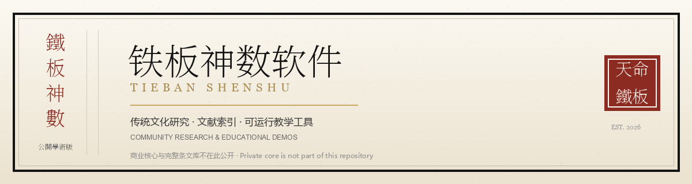

<p align="center">
  
</p>

<h1 align="center">铁板神数软件</h1>
<p align="center"><strong>Tieban Shenshu Community Edition</strong></p>

<p align="center">
  <strong>简体中文</strong> ｜
  <a href="README.zh-HK.md">繁體中文（香港／澳門）</a> ｜
  <a href="README.zh-TW.md">正體中文（台灣）</a> ｜
  <a href="README.en.md">English</a>
</p>

<p align="center">
  24 篇四语文档 · 6 个教学命令 · 26 项单元测试 · 5 项 CI 检查
</p>

🌐 **在线知识库（GitHub Pages）**：[立即阅读](https://tiebanshenshuapp-bot.github.io/tiebanshenshu/) —— 四语 25 页，无需克隆仓库。

---

## 六大入口

| | 入口 | 说明 |
|---|---|---|
| 📖 | **[入门总览](docs/zh-hans/index.md)** | 铁板神数是什么、与八字的区别、源流哪些清楚哪些不清楚 |
| 🔤 | **[术语表](docs/zh-hans/glossary.md)** | 考刻 / 定分 / 条文 / 太玄数，每条标注**证据层级** |
| 🛠 | **[网页教学工具](https://tiebanshenshuapp-bot.github.io/tiebanshenshu/tools/)** | **无需安装**，浏览器直接算：干支 / 甲子 / 术语 / 编号校验 / 引用 / 繁简 / 干支关系 |
| 💻 | **[命令行工具](demo/README.md)** | 零依赖 Python，7 个命令，可离线批量调用 |
| 📚 | **[源流与争议](docs/zh-hans/history.md)** | 时间线、杨慎的批评、哪些问题至今无解 |
| 🔬 | **[研究方法](docs/zh-hans/research-methods.md)** | 我们的判断标准、引用规范、如何评价我们的可信度 |
| 🌍 | **[公开项目调查](research/README.md)** | 19 个 GitHub 相关项目的许可分析（可复现） |

<p align="center">
  <a href="https://tiebanshenshuapp.com"><strong>官方网站</strong></a> ｜
  <a href="https://tiebanshenshuapp.com/trial"><strong>免费试算</strong></a> ｜
  <a href="CONTRIBUTING.md">参与贡献</a> ｜
  <a href="docs/zh-hans/faq.md">常见问题</a>
</p>

---

## 这是什么

本仓库是**铁板神数**（又作铁版神数、鐵板神數 / Tieban Shenshu）的**公开研究社区与教学演示**项目。

铁板神数是一套托名北宋邵雍的清代命理术数体系，以出生时间精确到「刻」的**考刻**推演著称，按数取条、依条断事。它是一份可供研究的传统文化文献，也是一段仍在被讨论真伪与源流的历史。

我们在这里公开的是：

- 铁板神数入门知识、术语说明与研究资料索引
- 独立、可运行的**教学工具**（不依赖任何商业引擎）
- 公开文献的出处与引用方法
- 少量**有明确来源标注**的公开示例

我们**不**在这里公开：

- 商业软件的私有引擎、完整条文库、完整考刻定分规则
- 商业客户端源码、安装包、授权与支付实现
- 任何客户姓名、生辰、命书或订单资料

> **商业软件与私有算法不在此仓库公开。** 完整功能请访问官方网站。

---

## 官方入口

| 用途 | 地址 | 状态 |
|---|---|---|
| 官方网站 | https://tiebanshenshuapp.com | 已核验可访问 |
| 免费试算 | https://tiebanshenshuapp.com/trial | 已核验为真实试算页 |

> 上述为**唯一正式入口**。本社区不提供商业软件下载，也不代表任何流派宣称正统。

---

## 快速开始（无需安装）

本仓库自带一个**零依赖**的教学工具，用 Python 3.9+ 即可直接运行：

```bash
git clone https://github.com/tiebanshenshuapp-bot/tiebanshenshu.git
cd tiebanshenshu/demo

# 1. 干支换算：公历年 → 干支
python tieban_open_tools.py ganzhi 1984

# 2. 六十甲子序号查询
python tieban_open_tools.py jiazi 甲子

# 3. 传统术语查询（标注"传统说法"与"学术讨论"）
python tieban_open_tools.py term 考刻

# 4. 条文编号格式校验（使用虚构样例，无真实条文）
python tieban_open_tools.py check 4082

# 5. 文献引用生成
python tieban_open_tools.py cite "皇极经世"
```

工具**只在本地运行**，不联网、不上传、不需要生辰资料。详见 [demo/README.md](demo/README.md)。

---

## 内容导览

| 文档 | 简体 | 香港 | 台湾 | 英文 |
|---|---|---|---|---|
| 入门总览 | [docs/zh-hans/index.md](docs/zh-hans/index.md) | [docs/zh-hk/index.md](docs/zh-hk/index.md) | [docs/zh-tw/index.md](docs/zh-tw/index.md) | [docs/en/index.md](docs/en/index.md) |
| 快速上手 | [getting-started](docs/zh-hans/getting-started.md) | [快速上手](docs/zh-hk/getting-started.md) | [快速上手](docs/zh-tw/getting-started.md) | [getting-started](docs/en/getting-started.md) |
| 术语表 | [glossary](docs/zh-hans/glossary.md) | [術語表](docs/zh-hk/glossary.md) | [術語表](docs/zh-tw/glossary.md) | [glossary](docs/en/glossary.md) |
| 源流与争议 | [history](docs/zh-hans/history.md) | [源流](docs/zh-hk/history.md) | [源流](docs/zh-tw/history.md) | [history](docs/en/history.md) |
| 研究方法 | [research-methods](docs/zh-hans/research-methods.md) | [研究方法](docs/zh-hk/research-methods.md) | [研究方法](docs/zh-tw/research-methods.md) | [research-methods](docs/en/research-methods.md) |
| 常见问题 | [faq](docs/zh-hans/faq.md) | [常見問題](docs/zh-hk/faq.md) | [常見問題](docs/zh-tw/faq.md) | [faq](docs/en/faq.md) |

---

## 研究方法：我们如何对待这份材料

本项目坚持三条：

**1. 区分史料层级**

| 层级 | 含义 | 我们的处理 |
|---|---|---|
| 古籍原文 | 清代及以前的刊本内容 | 引用并标注版本与来源 |
| 传统说法 | 师传、流派自述、民间传闻 | 明确标注「传统说法」，不当作史实 |
| 学术讨论 | 可查证的文献学研究 | 给出出处，允许多说并存 |
| 社区解释 | 本项目的整理与说明 | 标明为编者观点 |
| 虚构样例 | 为演示格式而造的假数据 | **显著标注为虚构** |

**2. 不宣称正统**

历史上关于铁板神数的源流、作者、传承存在明确争议。明代杨慎已批评「今世游食术人妄造大定数、蠢子数托名康节」。我们**不主张**任何「唯一正宗」「帝王秘传」「邵雍亲传」之说。

**3. 不做命运断言**

本项目讨论的是**文献与文化**，不是预测服务。铁板神数作为历史术数文献，不构成任何命运预测依据，请勿据以作出医疗、投资、法律或人生重大决策。

---

## 参与贡献

欢迎以下类型的贡献：

- 补充文献出处、版本信息、页码
- 纠正术语翻译与地方用语差异（香港 / 台湾）
- 改进教学工具的可读性与测试
- 报告文档事实错误
- 提出研究方法上的质疑

请先阅读 [CONTRIBUTING.md](CONTRIBUTING.md) 与 [CODE_OF_CONDUCT.md](CODE_OF_CONDUCT.md)。

**请不要提交**：真实生辰八字、姓名、命书、商业内部资料、来源不明的条文全文。

安全问题的报告方式见 [SECURITY.md](SECURITY.md)。

---

## 常见问题

**Q：这里有完整的 12000 条条文吗？**
A：没有。本仓库只收录**极少量**有来源标注的公开示例（累计上限 30 条），并严格标注出处。完整条文库属商业私有资产。

**Q：这个仓库的代码能商用吗？**
A：不能。本项目自有新增代码采用 **PolyForm Noncommercial 1.0.0**（源码公开、非商业使用），文档采用 **CC BY-NC 4.0**。详见下方许可证章节。注意这是 **Source Available**，不是 OSI 定义的开源许可。

**Q：那和官网是什么关系？**
A：官网 https://tiebanshenshuapp.com 是提供完整商业服务的唯一正式入口。本仓库是独立的知识与研究项目，不是商业完整版，也不是第二个算命网站。

**Q：工具准不准？**
A：工具只做**可公开核查的确定性计算**（干支换算、序数查询、格式校验）。它不实现私有取数链，不给出任何个人命运结论。

更多问题见 [FAQ](docs/zh-hans/faq.md)。

---

## 版本与状态

| 项目 | 值 |
|---|---|
| 社区版版本 | **v0.1.0**（独立编号，与商业软件版本无关） |
| 文档 | 24 篇（简体 6 / 香港 6 / 台湾 6 / 英文 6） |
| 教学工具 | 6 个命令，零外部依赖 |
| 测试 | 26 项，全部通过 |
| CI | 5 项检查（测试 / 安全门 / Markdown / 文档 / 链接） |
| 公开条文示例 | **0 条**（底本与权利未核实前不发布） |
| 内容更新 | 见 [CHANGELOG.md](CHANGELOG.md) |
| 计划 | 见 [ROADMAP.md](ROADMAP.md) |

> **诚实说明**：本仓库当前**没有任何真实流量数据**。我们不刷 Star、不买流量、不伪造评价。
> 访问量、搜索收录等信息在获得可验证来源前一律标注为「未知」。

---

## 许可证与商业边界

| 内容 | 许可 | 能否商用 |
|---|---|---|
| 本项目自有代码（`demo/`、`scripts/`） | [PolyForm Noncommercial 1.0.0](LICENSE) | ❌ 禁止商业使用 |
| 本项目自有文档（`docs/`、README） | [CC BY-NC 4.0](LICENSE-DOCS) | ❌ 禁止商业使用 |
| 清代公版古籍原文 | 公有领域 | ✅ 可自由使用 |
| 第三方素材 | 见 [THIRD_PARTY_NOTICES.md](THIRD_PARTY_NOTICES.md) | 按其原许可 |

> **重要**：本项目的自有新增成果采用 **Source Available（源码公开、非商业许可）**，**不是** OSI 标准开源。MIT / Apache / GPL 等标准开源许可允许商业使用，本项目不采用。
>
> 公有领域的古籍原文本身不受版权保护，我们不对其主张任何独占权利。

---

## 声明

- 铁板神数条文无善本定本，坊间抄本文字互有出入。
- 本项目为传统文化研究、数字人文与教学用途，**不构成任何命运预测依据**。
- 本项目不提供医疗、投资、法律建议。
- 品牌名称与官方入口归属见 [NOTICE.md](NOTICE.md)。

---

<div align="center">

[官方网站](https://tiebanshenshuapp.com) ｜ [免费试算](https://tiebanshenshuapp.com/trial) ｜ [讨论区](https://github.com/tiebanshenshuapp-bot/tiebanshenshu/discussions) ｜ [参与贡献](CONTRIBUTING.md) ｜ [安全问题](SECURITY.md)

</div>
