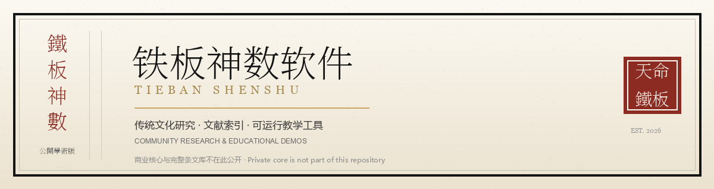

<p align="center">
  
</p>

<h1 align="center">鐵板神數軟體</h1>
<p align="center"><strong>Tieban Shenshu Community Edition</strong></p>

<p align="center">
  <a href="https://github.com/tiebanshenshuapp-bot/tiebanshenshu/releases"></a>
  <a href="https://github.com/tiebanshenshuapp-bot/tiebanshenshu/blob/main/LICENSE"></a>
  <a href="https://github.com/tiebanshenshuapp-bot/tiebanshenshu/actions"></a>
  <a href="https://tiebanshenshuapp-bot.github.io/tiebanshenshu/tools/"></a>
  <a href="https://github.com/tiebanshenshuapp-bot/tiebanshenshu/stargazers"></a>
</p>

<p align="center">
  <a href="README.md">简体中文</a> ｜
  <a href="README.zh-HK.md">繁體中文（香港／澳門）</a> ｜
  <strong>正體中文（台灣）</strong> ｜
  <a href="README.en.md">English</a>
</p>

<p align="center">
  24 篇四語文件 · 6 個教學指令 · 26 項單元測試 · 5 項 CI 檢查
</p>

🌐 **線上知識庫（GitHub Pages）**：[立即閱讀](https://tiebanshenshuapp-bot.github.io/tiebanshenshu/) —— 四語 25 頁，無需克隆倉庫。

---

## 六大入口

| | 入口 | 說明 |
|---|---|---|
| 📖 | **[入門總覽](docs/zh-tw/index.md)** | 鐵板神數是什麼、與八字的區別、源流哪些清楚哪些不清楚 |
| 🔤 | **[術語表](docs/zh-tw/glossary.md)** | 考刻 / 定分 / 條文 / 太玄數，每條標註**證據層級** |
| 🛠 | **[網頁教學工具](https://tiebanshenshuapp-bot.github.io/tiebanshenshu/tools/)** | **無需安裝**，瀏覽器直接算：干支 / 甲子 / 術語 / 編號校驗 / 引用 / 繁簡 / 干支關係 |
| 💻 | **[命令列工具](demo/README.md)** | 零依賴 Python，7 個指令，可離線批次呼叫 |
| 📚 | **[源流與爭議](docs/zh-tw/history.md)** | 時間線、楊慎的批評、哪些問題至今無解 |
| 🔬 | **[研究方法](docs/zh-tw/research-methods.md)** | 我們的判斷標準、引用規範、如何評價我們的可信度 |
| 🌍 | **[公開專案調查](research/README.md)** | 19 個 GitHub 相關專案的授權分析（可重現） |

<p align="center">
  <a href="https://tiebanshenshuapp.com?utm_source=github&utm_medium=referral&utm_campaign=tieban_community&utm_content=readme_link"><strong>官方網站</strong></a> ｜
  <a href="https://tiebanshenshuapp.com/trial?utm_source=github&utm_medium=referral&utm_campaign=tieban_community&utm_content=trial_cta"><strong>免費試算</strong></a> ｜
  <a href="CONTRIBUTING.md">參與貢獻</a> ｜
  <a href="docs/zh-tw/faq.md">常見問題</a>
</p>

---

## 這是什麼

本儲存庫是**鐵板神數**（又作鐵版神數、铁板神数 / Tieban Shenshu）的**公開研究社群與教學示範**專案。

鐵板神數是一套託名北宋邵雍的清代命理術數體系，以出生時間精確到「刻」的**考刻**推演著稱，按數取條、依條斷事。它是一份可供研究的傳統文化文獻，也是一段仍在被討論真偽與源流的歷史。

我們在這裡公開的是：

- 鐵板神數入門知識、術語說明與研究資料索引
- 獨立、可執行的**教學工具**（不依賴任何商業引擎）
- 公開文獻的出處與引用方法
- 少量**有明確來源標註**的公開示例

我們**不**在這裡公開：

- 商業軟體的私有引擎、完整條文庫、完整考刻定分規則
- 商業用戶端原始碼、安裝檔、授權與支付實作
- 任何客戶姓名、生辰、命書或訂單資料

> **商業軟體與私有演算法不在此儲存庫公開。** 完整功能請造訪官方網站。

---

## 官方入口

| 用途 | 位址 | 狀態 |
|---|---|---|
| 官方網站 | https://tiebanshenshuapp.com?utm_source=github&utm_medium=referral&utm_campaign=tieban_community&utm_content=readme_link | 已核實可造訪 |
| 免費試算 | https://tiebanshenshuapp.com/trial?utm_source=github&utm_medium=referral&utm_campaign=tieban_community&utm_content=trial_cta | 已核實為真實試算頁 |

> 上述為**唯一正式入口**。本社群不提供商業軟體下載，亦不代表任何流派宣稱正統。

---

## 快速開始（無需安裝）

本儲存庫自帶一個**零依賴**教學工具，用 Python 3.9+ 即可直接執行：

```bash
git clone https://github.com/tiebanshenshuapp-bot/tiebanshenshu.git
cd tiebanshenshu/demo

# 1. 干支換算：西元年 → 干支
python tieban_open_tools.py ganzhi 1984

# 2. 六十甲子序號查詢
python tieban_open_tools.py jiazi 甲子

# 3. 傳統術語查詢（標註「傳統說法」與「學術討論」）
python tieban_open_tools.py term 考刻

# 4. 條文編號格式檢查（使用虛構樣例，無真實條文）
python tieban_open_tools.py check 4082

# 5. 文獻引用產生
python tieban_open_tools.py cite "皇極經世"
```

工具**只在本地執行**，不連網、不上傳、不需要生辰資料。詳見 [demo/README.md](demo/README.md)。

---

## 內容導覽

| 文件 | 正體（台灣） |
|---|---|
| 入門總覽 | [docs/zh-tw/index.md](docs/zh-tw/index.md) |
| 快速上手 | [docs/zh-tw/getting-started.md](docs/zh-tw/getting-started.md) |
| 術語表 | [docs/zh-tw/glossary.md](docs/zh-tw/glossary.md) |
| 源流與爭議 | [docs/zh-tw/history.md](docs/zh-tw/history.md) |
| 研究方法 | [docs/zh-tw/research-methods.md](docs/zh-tw/research-methods.md) |
| 常見問題 | [docs/zh-tw/faq.md](docs/zh-tw/faq.md) |

其他語言：[简体中文](README.md) ｜ [繁體中文（香港／澳門）](README.zh-HK.md) ｜ [English](README.en.md)

---

## 研究方法：我們如何對待這份材料

本專案堅持三條：

**1. 區分史料層級**

| 層級 | 含義 | 我們的處理 |
|---|---|---|
| 古籍原文 | 清代及以前的刊本內容 | 引用並標註版本與來源 |
| 傳統說法 | 師傳、流派自述、民間傳聞 | 明確標註「傳統說法」，不當作史實 |
| 學術討論 | 可查證的文獻學研究 | 給出來源，容許多說並存 |
| 社群解釋 | 本專案的整理與說明 | 標明為編者觀點 |
| 虛構樣例 | 為示範格式而造的假資料 | **顯著標註為虛構** |

**2. 不宣稱正統**

歷史上關於鐵板神數的源流、作者、傳承存在明確爭議。明代楊慎已批評「今世游食術人妄造大定數、蠢子數託名康節」。我們**不主張**任何「唯一正宗」「帝王秘傳」「邵雍親傳」之說。

**3. 不做命運斷言**

本專案討論的是**文獻與文化**，不是預測服務。鐵板神數作為歷史術數文獻，不構成任何命運預測依據，請勿據以作出醫療、投資、法律或人生重大決定。

---

## 參與貢獻

歡迎以下類型的貢獻：

- 補充文獻出處、版本資料、頁碼
- 糾正術語翻譯與台灣本地用語差異
- 改善教學工具的可讀性與測試
- 報告文件事實錯誤
- 提出研究方法上的質疑

請先閱讀 [CONTRIBUTING.md](CONTRIBUTING.md) 與 [CODE_OF_CONDUCT.md](CODE_OF_CONDUCT.md)。

**請不要提交**：真實生辰八字、姓名、命書、商業內部資料、來源不明的條文全文。

安全問題的回報方式見 [SECURITY.md](SECURITY.md)。

---

## 常見問題

**Q：這裡有完整的 12000 條條文嗎？**
A：沒有。本儲存庫只收錄**極少量**有來源標註的公開示例（累計上限 30 條），並嚴格標註出處。完整條文庫屬商業私有資產。

**Q：這個儲存庫的程式碼可以商用嗎？**
A：不可以。本專案自有新增程式碼採用 **PolyForm Noncommercial 1.0.0**（原始碼公開、非商業使用），文件採用 **CC BY-NC 4.0**。請注意這是 **Source Available**，不是 OSI 定義的開源授權。

**Q：那和官網是什麼關係？**
A：官網 https://tiebanshenshuapp.com?utm_source=github&utm_medium=referral&utm_campaign=tieban_community&utm_content=readme_link 是提供完整商業服務的唯一正式入口。本儲存庫是獨立的知識與研究專案，不是商業完整版，也不是第二個算命網站。

**Q：工具準不準？**
A：工具只做**可公開核查的確定性計算**（干支換算、序號查詢、格式檢查）。它不實作私有取數鏈，不給出任何個人命運結論。

更多問題見 [常見問題](docs/zh-tw/faq.md)。

---

## 版本与状态

| 项目 | 值 |
|---|---|
| 社区版版本 | **v0.1.0**（独立编号，与商业软件版本无关） |
| 文档 | 24 篇（简体 6 / 香港 6 / 台湾 6 / 英文 6） |
| 教学工具 | 6 个命令，零外部依赖 |
| 测试 | 26 项，全部通过 |
| CI | 5 项检查（测试 / 安全门 / Markdown / 文档 / 链接） |
| 公开条文示例 | **0 条**（底本与权利未核实前不发布） |
| 内容更新 | 见 [CHANGELOG.md](CHANGELOG.md) |
| 计划 | 见 [ROADMAP.md](ROADMAP.md) |

> **诚实说明**：本仓库当前**没有任何真实流量数据**。我们不刷 Star、不买流量、不伪造评价。
> 访问量、搜索收录等信息在获得可验证来源前一律标注为「未知」。

---

## 授權與商業邊界

| 內容 | 授權 | 可否商用 |
|---|---|---|
| 本專案自有程式碼（`demo/`、`scripts/`） | [PolyForm Noncommercial 1.0.0](LICENSE) | ❌ 禁止商業使用 |
| 本專案自有文件（`docs/`、README） | [CC BY-NC 4.0](LICENSE-DOCS) | ❌ 禁止商業使用 |
| 清代公版古籍原文 | 公有領域 | ✅ 可自由使用 |
| 第三方素材 | 見 [THIRD_PARTY_NOTICES.md](THIRD_PARTY_NOTICES.md) | 按其原授權 |

> **重要**：本專案的自有新增成果採用 **Source Available（原始碼公開、非商業授權）**，**不是** OSI 標準開源。MIT / Apache / GPL 等標準開源授權允許商業使用，本專案不採用。
>
> 公有領域的古籍原文本身不受著作權保護，我們不對其主張任何獨佔權利。

---

## 聲明

- 鐵板神數條文無善本定本，坊間抄本文字互有出入。
- 本專案為傳統文化研究、數位人文與教學用途，**不構成任何命運預測依據**。
- 本專案不提供醫療、投資、法律建議。
- 品牌名稱與官方入口歸屬見 [NOTICE.md](NOTICE.md)。

---

[官方網站](https://tiebanshenshuapp.com?utm_source=github&utm_medium=referral&utm_campaign=tieban_community&utm_content=readme_link) ｜ [免費試算](https://tiebanshenshuapp.com/trial?utm_source=github&utm_medium=referral&utm_campaign=tieban_community&utm_content=trial_cta) ｜ [討論區](https://github.com/tiebanshenshuapp-bot/tiebanshenshu/discussions) ｜ [參與貢獻](CONTRIBUTING.md) ｜ [安全問題](SECURITY.md)